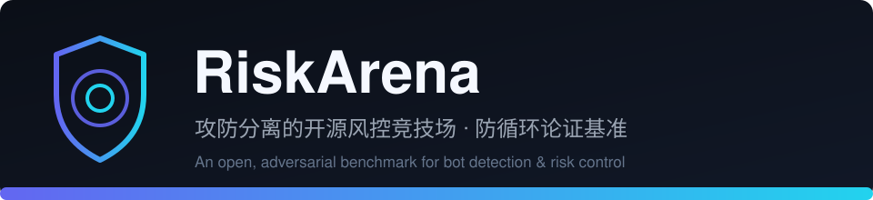

<p align="center">
  
</p>

# RiskArena —— 开放的风控攻防竞技场

**An open, adversarial benchmark for bot-detection / risk-control defenses.**

[](https://github.com/Justter-liu-jj/riskarena/actions/workflows/ci.yml)


> 你的防线的误伤率,不该由你自己写的机器人来打分。

## 三步打榜(30 秒上手)

1. **跑基线** —— `python -m riskarena tournament --trials 200`(纯标准库,零依赖)
2. **挑赛道** —— 防线:`scenarios/<你的场景>/` 实现 `Defense` 子类;标本:建 `specimens/` 目录
   放一个 `Specimen` 文件(CLI 自动发现,该目录不入库)
3. **提 PR** —— 附一次完整锦标赛输出;评审清单在 [CONTRIBUTING.md](CONTRIBUTING.md),
   红线在 [CHARTER.md](CHARTER.md)

跑不通算文档 bug —— 开 issue 贴报错,我们修文档而不是让你猜。

---

## 为什么要有这个仓库

风控(验证码、反自动化)研究有个老毛病:**防线和测试它的机器人是同一批人**。
自己训的模型,拿自己写的生成器一测,捕获率 99% —— 然后真实世界一来,
要么咬伤一半真人,要么被一段 0.15px 的亚像素噪声整个绕过
(我们在姊妹教学靶场 slider-captcha-lab —— 本地项目,尚未开源 —— 里把这条循环论证
亲手踩了一遍:同一个人写的防线和标本,pro 型标本通过率 100%,utility 满分,
自我感觉良好)。

C. Herley 在 USENIX Security '22 把这个问题定名:没有独立对抗的防御评估,
是 *the plight of the targeted defender*。

RiskArena 的结构性解法:**让攻防双方成为不同的人。**

```
防线作者 ──提交──> Defense(分层判定:协议/规则/模型/环境)
                        │
                        ▼ 只通过 Challenge / Submission 见面
标本作者 ──提交──> Specimen(行为生成器,bot 或 human 意图)
                        │
                        ▼
              裁判 referee(全知视角)
              独立复核 solved · 异常隔离 · 协议探针 · 统一计分 → leaderboard.json
```

- 标本只见 challenge 明文的深拷贝 + 每试次独立随机流 —— 改靶、污染随机、
  改写全场成绩都做不到;
- 防线只见 submission;它自报的 solved 会被裁判**用 `check_solved` 几何复核**
  —— 否则"凡拦截一律报没完成"一句话就能把误伤率刷成 0(这是我们的设计
  审查真的抓到的洞);
- 误伤率用**冻结的公开语料**回放(证据等级与完整披露见
  `data/corpus/PROVENANCE.md`),不用防线作者自己的"人类模拟器"。

## 快速开始(1 分钟,纯标准库,零依赖)

```bash
python -m riskarena tournament --trials 200
python -m riskarena leaderboard
python -m riskarena specimens
```

当前基线(2026-10,seed=2026,trials=200,slider-v3@3.2.0,含语料回放):

```
  specimen                             intent    n  blocked  solved  layers(通过率)
  rookie                               bot     200   100.0%  100.0%  protocol 100% · rules 0% · model 0% · env 0%
  pro                                  bot     200     0.0%  100.0%  protocol 100% · rules 100% · model 100% · env 100%
  sneaky                               bot     200   100.0%  100.0%  protocol 100% · rules 100% · model 0% · env 100%
  slow-drag-fp                         bot     200     0.0%  100.0%  protocol 100% · rules 100% · model 100% · env 100%
  human-sim                            human   200     0.0%  100.0%  protocol 100% · rules 100% · model 100% · env 100%
  sloppy-sim                           human   200    32.5%   70.5%  protocol 100% · rules 96% · model 100% · env 100%
  corpus-human·1050                    human   200     9.5%   92.0%  protocol 100% · rules 100% · model 98% · env 100%

  verified_solved True(solved_mismatches 0) · rankable True · disqualified False
  catch 50.0% · deep_catch 50.0% · fp 1.5% · utility +0.455 (λ=3.0)
  protocol: {'replay_challenge': 'passed | challenge 一次性', 'forged_ticket': 'passed | 伪造票据全部拒绝', 'ticket_replay': 'passed | 票据单次性'}
```

读法:
- **sloppy-sim 32.5% 被拦但只有 1.5% 记误伤** —— "没对准滑块"是重试,
  `solved ∧ blocked` 才是被当贼;两者混淆曾让首场锦标赛的 utility 从
  +0.65 崩到 −0.14(见下"上线第一天")。
- **corpus-human 9.5% 被拦 / 92% 完成**:8% 是语料真实的松手失准(重试),
  ~1.5% 是模型层真实咬伤 —— 这是靶点锚定回放手术保住失手率之后才看得见的。
- **slow-drag-fp 与 pro 全过** = 这条防线的已知上限:前者是首位贡献者
  在冷启动测试里写出的通过配方(极慢匀速 + 一次终点修正 + 合格指纹;
  模型层把"极慢"判成满分真人),后者是实验室的满级标本。
  黑盒联赛里,新防线见不到它们直到上榜。

## 上线第一天,竞技场抓到了三个 bug(包括它自己的)

把语料接进来的第一场锦标赛,utility 从 +0.647 掉到 **−0.143**。
逐层验尸(`tools/debug_verdicts.py`)后修了三件事:

1. **指标混淆**:把"没对准滑块"计成了"误伤真人"。→ 误伤率改用 accused 率,
   另设 `HUMAN_SOLVE_FLOOR=0.5`:把挑战做得连真人都完不成的防线
   直接取消评分资格(榜单沉底,不是摆设 —— 榜单写入与排序强制执行)。
2. **机器速度伪影**:锦标赛以机器速度连发试次,human-sim 和语料回放共用
   静态指纹,把防线的 60s 频控(240 次)打爆 → 80% 的"误伤"其实是
   "同一个指纹每秒上千次验证"被忠实拦截。→ 锦标赛语义定为
   **每试次重置时间域状态**(i.i.d. 独立访客),频控这类时间域层
   明确移出榜单计分(见 `docs/league-rules.md`),要评它得等会话模式。
3. **裁判诚信**:设计审查(独立 agent)抓到 solved 由防线自报、
   disqualified 是死代码、标本可篡改 challenge 原对象、`--seed` 管不住
   挑战抽样。→ 裁判现在用 `Defense.check_solved` 独立复核 solved 并把
   矛盾记入 `solved_mismatches`;榜单强制执行 rankable/disqualified;
   标本拿到 challenge 深拷贝与每试次独立随机流;`defense.seed()` 接管
   挑战抽样;逐试次异常隔离(一个第三方标本炸不掉整场矩阵)。

另外,独立贡献者标本 `slow-drag-fp` 在冷启动测试中发现了新的通过配方
(见上)。**换一批人来打分,结论才会动 —— 这个仓库的全部意义。**

## 指标

```
utility = catch_rate − λ · fp_rate        (λ = 3:咬伤一个真人 ≈ 放过 3 次机器)
catch_rate = 机器人标本的宏观平均拦截率
fp_rate    = 真人标本 "完成了任务仍被拦"(accused)的宏观平均率
deep_catch_rate = 机器人完成拼图之后仍被拦的比例(防线在拼图之外的真实甄别力)
human_solved_rate < 0.5 → disqualified(榜单沉底)
无人类标本 → rankable = False(没有误伤率,utility 无意义,不参与排名)
verified_solved / solved_mismatches = 裁判是否独立复核了 solved、矛盾几处
协议探针   = challenge 一次性 / 伪造票据 / 票据单次性,任一 HOLE 写进榜单
```

## 联赛

- **白盒联赛**:标本可 import 防线代码,榜单单独标注 —— 用于定向压测。
- **黑盒联赛**:标本只见 challenge;防线上榜时发布的是可跑实例,
  权重不公开的版本由维护者持私有副本跑同一裁判(防"看榜调参到语料上")。

## 语料纪律(防循环论证的第二根支柱)

- 只接**许可明确的公开数据集**,无许可证默认拒绝(哪怕代码开源)。
- **证据分级**:语料按可核实性标注 —— `synthetic`(生成器)<
  `purported-human`(自称真人、不可核实)< `verified-human`(有采集
  方法与伦理记录)。当前语料为 **purported-human**:
  [NingNing0111/slider-track-model](https://github.com/NingNing0111/slider-track-model)
  (MIT,全文随附于 `data/corpus/LICENSE-ningning.txt`)的真人采集训练集
  1050 条。**必须知情**:上游项目本身是 WGAN-GP 轨迹生成器(自述目标
  含通过滑块行为检测),我们摄入的是其训练数据而非生成输出;"真人"
  标注不可核实,采集环节无知情同意记录 —— 完整披露见
  [data/corpus/PROVENANCE.md](data/corpus/PROVENANCE.md)。
- 核查过并**拒绝**的:BeCAPTCHA-Mouse(需邮件签署 EMA)、
  geetest_track(无许可证)、SapiMouse(无数据许可证,且是自由鼠标不是验证码)。
- 回放手术:位移差 ≤5% 纯平移;超差则**时空等比缩放**(靶点锚定,
  保速度剖面与松手误差)—— 只缩不缩时间的方案已被审查推翻并废弃。

## 目录

```
riskarena/            接口契约、裁判、指标、语料(框架核心)
scenarios/slider/     滑块场景:slider-v3 四层防线 + 内置标本
specimens/            你的本地标本放这里,CLI 自动发现(不入库)
tools/                语料转换、验尸调试、红线机械检查
data/corpus/          冻结语料 + PROVENANCE.md + 上游 LICENSE 全文
docs/                 架构、联赛规则、防线/标本贡献指南
.github/workflows/    CI:红线检查 + 基线锦标赛
CHARTER.md            红线:只打自家实例、合成标本、许可语料、黑盒纪律
```

## 参与贡献

两条赛道,见 [CONTRIBUTING.md](CONTRIBUTING.md):
**提交防线**(接受标本矩阵的审判)或**提交标本**(给现有防线出难题)。
本地试验:把标本文件丢进 `specimens/` 即被 `python -m riskarena tournament`
自动发现,或 `--specimen 路径:类名` 显式指定。
冷启动承诺:只按文档走,30 分钟内应能跑通你的第一次锦标赛 ——
跑不通算文档 bug,请开 issue(本项目首任贡献者就是按这条流程走完的,
文档断点已修)。

## 已知局限(诚实清单)

- 行为模型是 13 特征逻辑回归、语料是单一采集组件的窄切片(自称真人、
  不可核实、y 近零、拖距 120~270px)—— 结论只在滑块场景内成立,
  换场景请重测;找到 verified-human 语料请按 CONTRIBUTING 提交;
- 频控/信誉等时间域层在锦标赛语义下**不计分**(等会话模式);
- slow-drag-fp / pro 型标本 100% 通过是**设计内的事实**:它们定义了
  这条防线的已知上界,竞技场的任务是让"下一条防线"把这些上界打下来。

## 许可

代码 Apache-2.0(`LICENSE`);语料沿各自许可
(`data/corpus/LICENSE-ningning.txt` + `PROVENANCE.md`)。
红线见 [CHARTER.md](CHARTER.md):**只打本仓库内置的防线实例,永不指向真实站点。**
